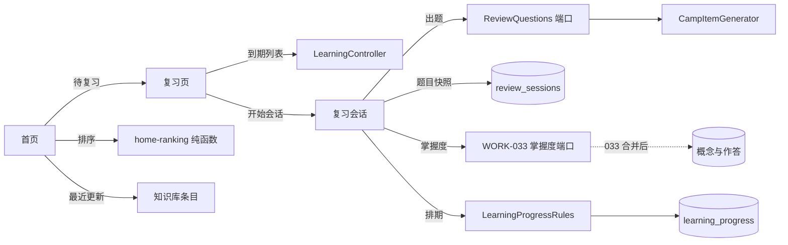

# 设计 · 学习闭环与复习入口

## 系统上下文



## 组件与职责

| 组件 | 职责 | 改动 |
| --- | --- | --- |
| `HomePage.tsx` | 出口改 `/review`；渲染排序结果与理由；零数据三步路径；训练营卡片 | 修改 |
| `home-ranking.ts`（计划） | 纯函数：候选条目 + 本人信号 → 带理由的顺序；放在 `@paideia/knowledge` 以便复用现有 vitest | 新建 |
| `HomeFirstRun.tsx`（计划） | 三步路径；`localStorage` 记住关闭 | 新建 |
| `ReviewPage.tsx`（计划） | 到期列表、会话、结果；无 AI 时仍可看列表 | 新建 |
| `router.tsx` | 新增 `/review` | 修改 |
| `LearnerHeader.tsx` | 导航补「复习」入口 | 修改 |
| `LearningController.java` | `GET /learning/reviews`；S2 两个会话端点 | 修改 |
| `LearningReviewService.java`（计划） | 到期列表组装、会话创建/提交、降级 | 新建 |
| `ReviewSessionsMapper.java`（计划） | `review_sessions` 的读写 | 新建 |
| `LearningProgressRules.java` | 新增 `afterReview(...)`：答对前进、答错明天 | 修改 |
| `ReviewQuestions.java`（计划，ai 根包） | 出题端口，返回题目与用量 | 新建 |
| `ReviewQuestionGenerator.java`（计划） | 复用 `CampItemGenerator` 与 `ItemValidator` 的实现 | 新建 |
| `MasteryRecorder`（033 计划） | 按概念写入掌握度 | 消费，不修改 |

## 请求或事件流程

**S1 到期列表**

1. `HomePage` 点「待复习」→ `/review`。
2. `ReviewPage` 调 `GET /learning/reviews`。
3. `LearningReviewService` 调现有 `KnowledgeApi.dueReviews(userId, 20)`，按概念 id 批量取概念名，返回按 `reviewDueAt` 升序的列表。
4. 无到期项：返回空列表，页面显示「去学习线 / 去知识库」。

**S2 发起会话**

1. 用户点「开始复习」。
2. 服务端先查该用户是否有未过期且未完成的 `review_sessions` 行；有则直接返回同一份题（幂等）。
3. 没有则取到期概念，最多 5 个；把最近 3 次会话的题干指纹作为 `previousStems`。
4. 调 `ReviewQuestions.generate(userId, concepts, 1, previousStems)`；一次调用。
5. 生成结果校验：每题 4 个选项、答案下标合法、题干 200 字以内、解析非空、指纹不在 `previousStems`。
6. 预扣积分成功后写入 `review_sessions`（`items_json` 含答案，`expires_at = now + 30min`）；失败则退款并返回降级。

**S2 提交**

1. `POST /learning/reviews/sessions/{id}/answers`，body 只有 `answers: [{itemId, choice}]`。
2. 校验归属、未完成、未过期；缺答或多答都拒绝。
3. 服务端用 `items_json` 判定对错，写 `answers_json`、`completed_at`。
4. 对每个概念：全对 → `LearningProgressRules.nextStage` 并 `dueAt(now, stage)`；有错 → 档位不变、`dueAt = now + 1 天`。
5. 调 033 的 `MasteryRecorder.record(userId, conceptId, correct, now)`；更新承载条目的 `learning_progress`。
6. 返回每题对错、解析、排期变化。

## 接口与数据

**`GET /learning/reviews`**

```json
{
  "items": [
    {
      "entryId": 42,
      "title": "MySQL 索引失效",
      "conceptId": 7,
      "conceptName": "索引",
      "reviewDueAt": "2026-10-22T00:00:00Z",
      "stage": 2
    }
  ],
  "total": 1
}
```

**`POST /learning/reviews/sessions`**

请求：`{}`（服务端取到期概念，不接受客户端指定 userId）。响应：

```json
{
  "sessionId": 18,
  "items": [
    { "itemId": 0, "conceptId": 7, "stem": "……", "options": ["A", "B", "C", "D"] }
  ],
  "expiresAt": "2026-10-22T19:30:00Z",
  "fallback": null
}
```

**`POST /learning/reviews/sessions/{id}/answers`**

请求：`{ "answers": [{ "itemId": 0, "choice": 2 }] }`。响应：

```json
{
  "results": [
    { "itemId": 0, "conceptId": 7, "correct": true, "explanation": "……" }
  ],
  "schedule": [
    { "entryId": 42, "stage": 3, "reviewDueAt": "2026-11-12T00:00:00Z" }
  ]
}
```

响应**永不包含** `answerIndex`；`itemId` 是会话内序号，不是题库 id。

**`review_sessions`（S2 新表，计划名）**

| 列 | 类型 | 说明 |
| --- | --- | --- |
| `id` | BIGINT UNSIGNED | 自增主键 |
| `user_id` | BIGINT UNSIGNED | 归属；每条查询都带 |
| `concept_ids_json` | JSON | 本次覆盖的概念 id |
| `items_json` | JSON | 题干、选项、答案下标、解析、指纹；**不下发答案** |
| `answers_json` | JSON NULL | 交卷后写入 |
| `created_at` | DATETIME(3) | 应用传 UTC |
| `expires_at` | DATETIME(3) | 30 分钟后不可提交 |
| `completed_at` | DATETIME(3) NULL | 幂等闸 |

不建到 `knowledge_*` 的外键（与 V1/V4/V15/V16 一致）；注销由 `KnowledgeUserDeletionListener` 的表清单加一行。

## 持久化与迁移

- **S1：零迁移。** 到期列表复用 `learning_progress` 与 `knowledge_concepts`；首页排序全在前端。
- **S2：一次迁移**，新增 `review_sessions`。文件名计划为 `V20261022190000__create_review_sessions.sql`，实际落笔前按合并时的最新时间戳重取，避免与 033 撞号。
- 不新增题库表、不扩展 `knowledge_entries`、不改 033 的题目身份。
- `learning_progress.review_stage/review_due_at` 是既有列，S2 只写不扩。
- 生产迁移只建结构；测试/开发数据放 `db/devdata`。

## 失败处理与恢复

| 情形 | 行为 | 用户看到 |
| --- | --- | --- |
| 没有到期项 | 不生成、不扣费 | 空状态 + 两个去处 |
| 生成超时（30s） | 不写会话、退款 | 「这次没能出题」+ 承载条目链接 + 重做文内小测 |
| 积分不足 | 不调用上游 | 同上，附「积分不足」 |
| 上游 5xx / 解析失败 | 不写会话、退款 | 同上 |
| 已有一个未完成会话 | 返回同一份题 | 直接继续 |
| 会话过期 | 允许重新发起 | 「上一轮已过期，重新开始」 |
| 重复提交 | 条件更新失败 → 409 | 「这一轮已经交过了」 |
| 另一个标签页已更新排期 | 提交时以数据库当前值为准，不覆盖 | 结果页显示最新排期 |

## 安全与权限

- `userId` 只从认证上下文取；请求体、路径都不接受。
- 会话按 `user_id + id` 查询；他人会话返回 404，不泄露存在性。
- 答案键只存在服务端；响应与日志都不带。
- 提交时校验 `answers` 的 `itemId` 必须属于该会话，且不能重复。
- 生成上游只接收概念名/摘要与已答题干，不发送用户笔记、简历或对话。
- 同一用户同时只允许一个未完成会话；重复发起返回现有会话，不重复扣费。

## 可观测性

- `ai_runs.kind = "review_generate"`，记录模型、提示词版本、token、耗时、`harness = null`。
- 降级时日志记 `reason`（timeout / credits / upstream / invalid），不记题目正文。
- 结果页与日志可回答：本次覆盖几个概念、是否命中 `previousStems`、是否退款。
- 首页排序不埋点；理由字符串由纯函数产出，便于测试断言。

## 实施顺序

1. S1-1：`home-ranking.ts` + 单测。
2. S1-2：`GET /learning/reviews` + `ReviewPage` 列表 + 路由/导航。
3. S1-3：`HomeFirstRun` + 训练营卡片 + `home.spec.ts` 更新。
4. S2-1（blocked）：探测 033 的掌握度端口，结论写入 `.agent/notes/review-mastery-contract.md`。
5. S2-2：`ReviewQuestions` 端口 + `ReviewQuestionGenerator` + 会话创建端点。
6. S2-3：交卷与排期更新 + `LearningProgressRules.afterReview`。
7. S2-4：会话页与结果页 + `review.spec.ts`。
8. S2-5：20–30 条金标 + 一次回归。

## 测试策略

| 层 | 覆盖 | 命令 |
| --- | --- | --- |
| 纯函数 | 排序优先级、理由、平局；`afterReview` 答对/答错/重复 | `pnpm --filter @paideia/knowledge test`；`scripts/test-db.sh mvn -B -pl paideia-knowledge -am -Dtest=LearningProgressRulesTest test` |
| 切片 | 到期列表空/非空、会话归属、重复提交、过期 | `scripts/test-db.sh mvn -B -pl paideia-app -am -Dtest=LearningProgressIntegrationTest test`（新增用例） |
| 降级 | 超时、积分不足、上游 5xx、解析失败 | 同一集成测试内用桩替换 `ReviewQuestions`，断言不扣费、无 5xx |
| e2e | 首页 → `/review` → 会话 → 结果 → 排期；零数据三步；移动端 | `cd frontend && pnpm --filter @paideia/app exec playwright test e2e/home.spec.ts e2e/review.spec.ts e2e/layout.mobile.spec.ts` |
| 数据 | 注销级联 | SQL 断言：`review_sessions` 无该用户行 |

## 需求追踪

| 需求 | 设计落点 | 验收 |
| --- | --- | --- |
| REQ-001 | `HomePage` 出口；`ReviewPage` 无 AI 可打开 | AC-001 |
| REQ-002 | `GET /learning/reviews` + 列表/空状态 | AC-002 |
| REQ-003 | 会话端点 + `ReviewPage` 逐题 | AC-003 |
| REQ-004 | `previousStems` + 指纹校验 + 跳过重复概念 | AC-004 |
| REQ-005 | `afterReview` + `MasteryRecorder` + 幂等 | AC-003、AC-011 |
| REQ-006 | `home-ranking.ts` + 理由 | AC-006 |
| REQ-007 | `HomeFirstRun` + `localStorage` | AC-007 |
| REQ-008 | `QUICK_LINKS` 固定卡片 | AC-008 |
| REQ-009 | 预扣/退款 + `ai_runs` + 降级 | AC-005 |
| REQ-010 | 归属校验 + 答案键不下发 | AC-009 |
| REQ-011 | S1 零迁移；S2 仅 `review_sessions` | AC-011 |
| REQ-012 | 375px、键盘、reduced-motion | AC-010 |

## 待决定事项

1. **掌握度端口**：033 若只提供读接口，S2 的 `MasteryRecorder` 调用需要改为「只写 `learning_progress`，掌握度等 033 接入」。S2-1 的探测任务先回答这一点。
2. **答错排期**：本设计按「档位不变、明天再来」；若用户选择回退一档，只改 `afterReview` 与 AC-003。
3. **会话规模**：一期 5 概念 × 1 题；若改为可选 3/5/10，端点多一个 `count` 参数，其余不变。
