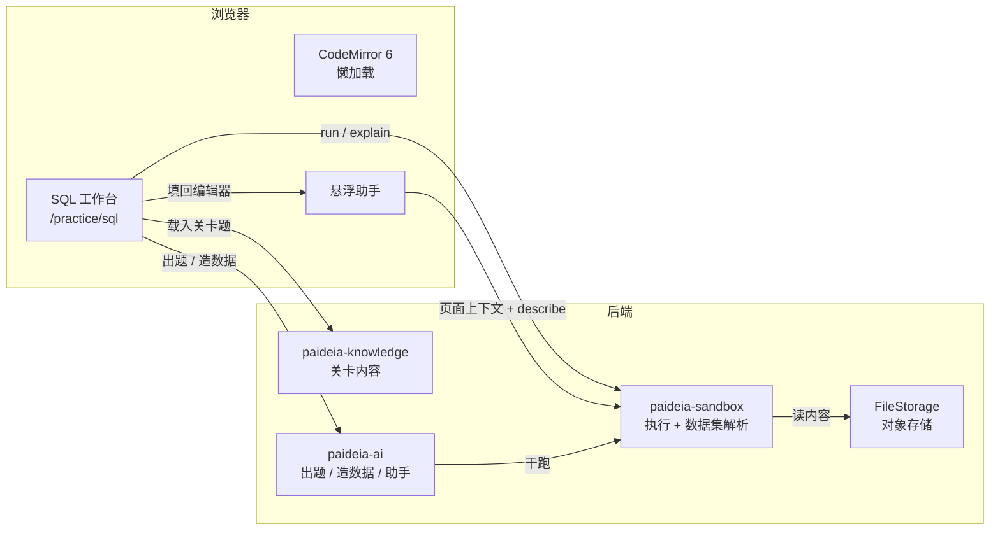
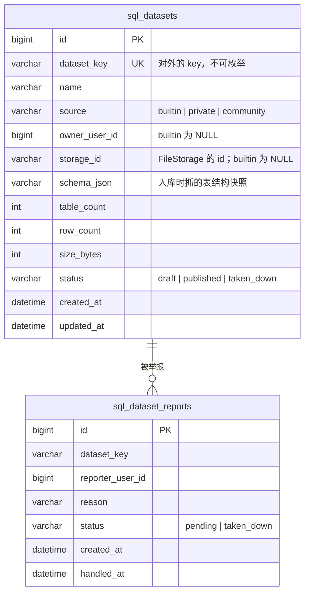

# 设计 · SQL 工作台、数据集与 AI 联动

## 系统上下文



## 数据模型

### 新增表



**为什么 `dataset_key` 与 `id` 分开**：`id` 是自增主键（项目约定），但对外标识不能是自增数——否则枚举 `/sandbox/run` 的 `dataset` 参数就能扫出所有私人数据集。`dataset_key` 用 UUID，形状与 `FileStorage` 的 id 一致。

**为什么 `schema_json` 存快照而不是每次现查**：现查要起容器（3 秒 + 一次配额），而 schema 在数据集内容不变时也不会变。写入时机是「入库成功之后、状态置为可用之前」。

**为什么不建 `builtin` 行**：内置数据集永远在 classpath，不依赖对象存储。把它们也塞进表会让「对象存储挂了」连累内置集。解析时先查表、查不到再查 classpath 注册表。

### 既有表

- `code_runs`：**不改结构**。`explain` 开关产生的运行仍写一条，`case_id` 沿用（可选），便于回答「这个人今天跑的都是 EXPLAIN 还是真查询」。
- 注销级联：`sql_datasets` 与 `sql_dataset_reports` 都要进 `AccountDeletionService` 的表清单——**私人数据集与举报记录都是用户数据**。社区数据集在被注销用户拥有时**不删**，改为 `owner_user_id = NULL` 并保留（否则别人引用中的社区数据集会消失）；这一条要在代码里显式写出，不能靠默认行为。

## 数据集解析

```
sql(userId, key):
  1. 查 classpath 注册表（内置）→ 命中即返回
  2. 查 sql_datasets by dataset_key
     - 不存在 → null（调用方 400）
     - source=private 且 owner_user_id != userId → null（调用方 400，**不区分"不存在"与"无权限"**）
     - status=taken_down → null
     - source=community 且 status=published → 允许
     - source=private 且 owner 是自己 → 允许
  3. FileStorage.read(storage_id) → 内容
```

**「不区分不存在与无权限」是刻意的**：区分了就等于给出一个枚举 oracle，攻击者能靠 400 的文案差异确认某个 key 存在。

**签名改造的检查点**：`sql(String key)` 直接删掉而不是重载。留一个旧签名，将来一定会有人调到它，而它没有用户参数——那是越权。

## 上传与干跑

```
POST /api/v1/sql-datasets（multipart）
  → 大小检查（≤ 512 KB）
  → 语句白名单解析（只许 CREATE TABLE/INDEX/VIEW、INSERT）
  → 沙箱干跑：用一个**一次性**的验证 key 灌进去
  → 成功 → FileStorage.put → 抓 schema → 落表
  → 失败 → 返回可读原因，不落任何东西
```

**为什么干跑用一次性 key 而不是先落表再试**：落表后失败要回滚两处（表 + 文件），而回滚失败会留下一个「存在但不可用」的数据集。先试后存只有一处写入。

**语句白名单必须自己解析而不是靠 MySQL 拒**：`LOAD DATA`、`CREATE TRIGGER`、`CREATE PROCEDURE` 在 MySQL 里都是合法的，但它们是「在沙箱里执行任意逻辑」的入口。沙箱本身有隔离，但数据集内容会被**别人的运行**重复执行——一旦里面藏了 `TRIGGER`，它在每次别人跑 SQL 时都执行一次。

## 执行计划

`/sandbox/run` 加 `explain: boolean`。为 true 时容器脚本在同一次 `mysql` 调用里先跑 `EXPLAIN FORMAT=TREE <user sql>` 再跑用户 SQL，或者只跑前者（见下）。

**取舍**：一次运行只跑一种，避免结果集混在一起难以区分。

- `explain=true` → 只跑 `EXPLAIN FORMAT=TREE`，返回一份结果集
- `explain=false` → 现在的行为

前端点「看执行计划」时发一次 `explain=true` 的运行。这仍是一次配额与一次容器启动，但**不会**比跑一次 SQL 更贵。用户看到的是「这句走了索引还是全表扫」。

**降级**：`EXPLAIN FORMAT=TREE` 在 MySQL 8.0 才有（5.7 要 `EXPLAIN FORMAT=JSON` 或默认表格）。镜像钉的是 8.0，所以直接可用；若将来降版本，退回默认 `EXPLAIN` 表格形态并标注。

## 前端结构

### 包划分

| 位置 | 内容 |
| --- | --- |
| `frontend/packages/sql-workbench/`（新增） | 工作台全部组件：编辑器封装、结果表、schema 侧栏、ER 图、执行计划树、图表。**独立包**，不进 `@paideia/ui` |
| `frontend/apps/app/src/pages/SqlPracticePage.tsx` | 组合根：拿数据、接路由、接助手上下文 |

**为什么独立包**：CodeMirror 与图表库是本项目唯一的重前端依赖，放 `@paideia/ui` 会让管理端与桌面端也带上它们（`ui` 是所有应用的共享包）。独立包只在 `@paideia/app` 里被引用，且用 `lazy()` 引入。

### 懒加载

```tsx
const SqlWorkbench = lazy(() => import('@paideia/sql-workbench'))
```

必须验证：未进入 `/practice/sql` 时，构建产物里编辑器代码在独立 chunk 中且未被主 chunk 引用。这一条做成构建期检查（读 `dist/assets/*.js` 找主 chunk 的 import 图），而不是靠人眼看。

### 补全的 schema 来源

`sql_describe_dataset` 与前端补全共用同一份数据：`/api/v1/sql-datasets/{key}/schema`。它返回 `schema_json` 的内容（或内置数据集的静态快照）。

**内置数据集的 schema 快照怎么来**：加数据集时由脚本生成一次并提交进仓库（`sandbox/datasets/*.schema.json`），与 `.sql` 同目录。不在运行时抓——内置集不该在首次访问时多等 3 秒。

## 助手联动

### 页面上下文

`AssistantContextValue` 增加一个**有界的**场景对象：

```ts
interface PageContext {
  kind: 'sql-workbench'
  datasetKey: string
  draftSql: string        // 截断到 2000 字符
  lastResult: string      // 截断到 800 字符；只放错误或行数摘要，不放数据行
}
```

**为什么不放数据行**：结果集可能上千行，塞进提示词既贵又可能把用户没想分享的数据送进模型。只放「报错原文」或「返回 3 列 12 行」，足够模型判断问题在哪。

**为什么单独开一个字段而不是塞进 `entryTitle`**：`entryId` 那套是「正在读哪条知识」，语义完全不同；混用会让条目页的清理逻辑（`setEntry(null)`）把 SQL 上下文一起清掉。

### 只读工具 `sql_describe_dataset`

```java
new ToolDescriptor(
    "sql_describe_dataset", "sql", "查看数据集表结构",
    "给数据集 key 返回它的表、列、类型与主键。不返回数据行。",
    schema, null, /*readOnly*/ true, false, true, ToolScope.READ, true);
```

**它属于 `sql` 组**，而 `sql` 组只在 `ASSISTANT` 与 `TUTOR` 的 `toolsetsOf` 里出现。`INTERVIEW` 与 `REVIEW` 不加——面试官不需要看你的 SQL 练习库。

**工具内部必须自己再校验一次权限**：工具拿到的是 `context.userId`，`sql_describe_dataset` 内部走同一个 `sql(userId, key)` 权限判定。不能假设「模型只会传自己有权的 key」。

### 填回编辑器

`AssistantContextValue` 增加 `applySql(text: string)`，与既有的 `ask()` 同一形状（写一个待消费对象，页面消费一次就清）。**不是工具**：助手在回答里给一段 SQL 代码块，前端渲染时带一个「填入编辑器」按钮（复用 markdown 渲染器的按钮注入机制，与 WORK-014 的「问 AI」同源）。

这样助手不需要知道「编辑器」这个概念，它只是正常回答；按钮是前端的渲染能力。

## 配额与并发

```
requireQuota(userId, language)   // 日上限：SQL 500，其它 50
RunSlot.acquire(userId)          // 全局 2 + 每人 1
```

**每人并发 1 怎么实现**：`RunSlot` 内部维护 `Map<Long, Boolean>`（或 `ConcurrentHashMap.newKeySet()`），acquire 时先 tryAdd(userId)，失败抛「你有一个查询还在跑」。全局信号量仍然存在，两层都要过。

**释放顺序**：`close()` 里先还全局槽再移除 userId 标记；反过来的话，用户在标记移除后、全局槽释放前重试，会拿到「忙」而实际上没人在跑——不致命但会让人困惑。

**日上限 500 的定位**：它不是预算，是熔断。页面上不常驻显示，只在 `remaining <= 20` 时提示。`/sandbox/status` 仍返回数字（前端要判断阈值），但界面不展示大数字。

## 管理端

新增两页，进既有侧栏：

- **数据集管理**：列出社区数据集（按状态筛选），可下架/恢复；显示作者、举报数。
- **举报处理**：照搬 `NoteReportsPage` 的四状态形状（pending / taken_down），可一键下架。

## 已知限制

- **ER 图里的关联关系不全来自外键**：课程第 08 课专门讲「很多团队不用外键」，所以数据集里可能一张外键都没有。此时 ER 图只画表与列，不画连线；作者可在数据集元信息里手工标注关联（`schema_json` 里留一个 `relations` 数组）。
- **结果图表只支持柱状与折线**：饼图与散点图不在本期。
- **社区数据集没有搜索与排序**：只按名称分组，靠数量增长后再看。
- **AI 出题不能保证题目唯一性**：判定口径显式化只能减少歧义，不能消除。题面里写清「要哪几列、要不要排序、NULL 怎么算」，这是能做到的上限。
- **`explain=true` 仍占一次配额**：它确实起了一个容器。若将来觉得不合理，可以单独给它一个不计入的豁免，但那会让「配额 = 容器启动次数」这条口径变模糊。
