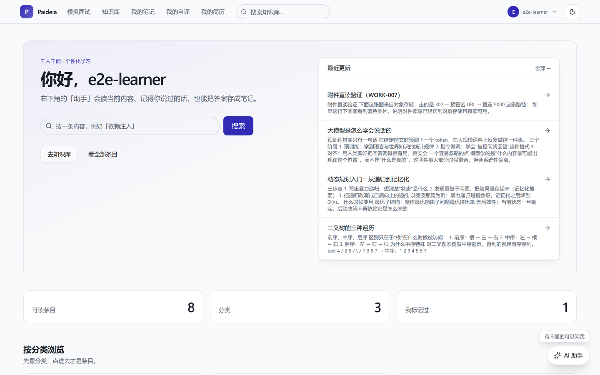
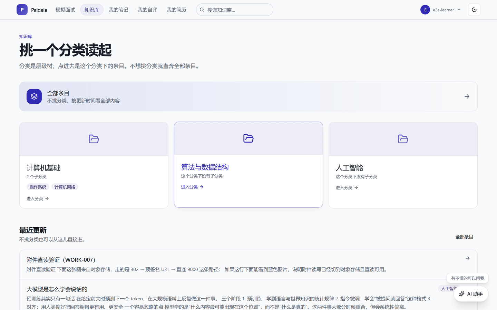
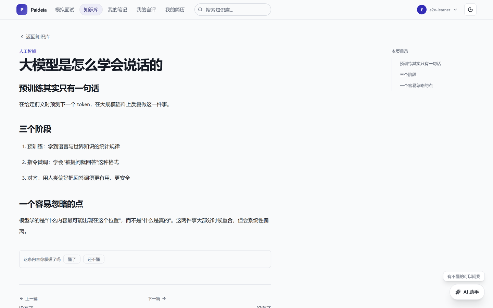
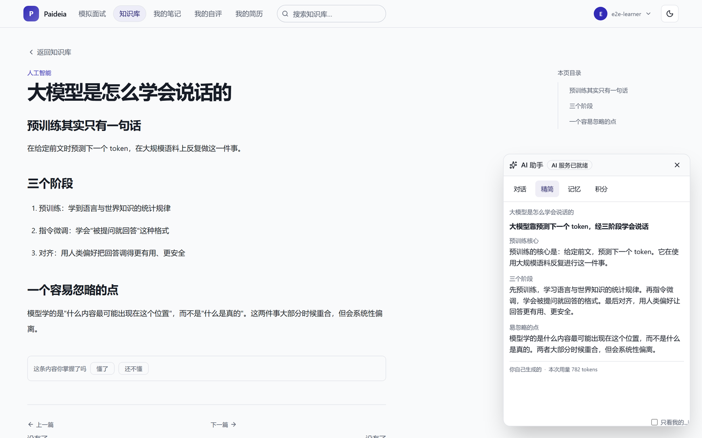
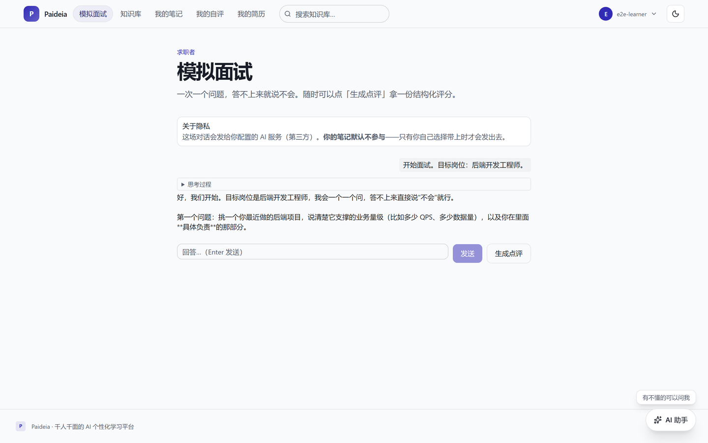
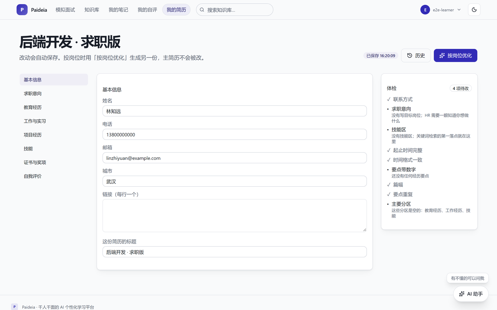
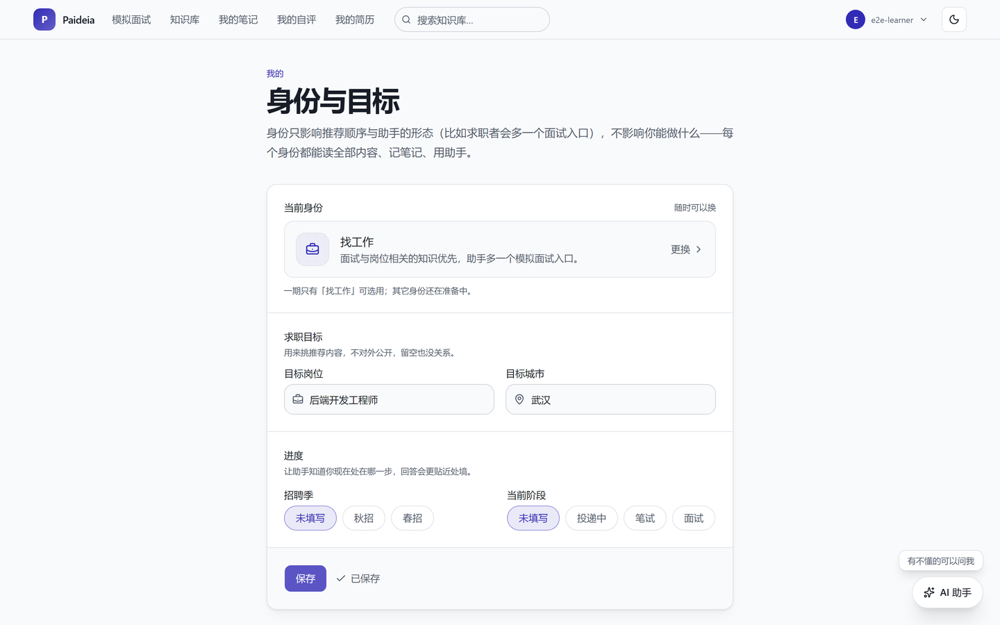
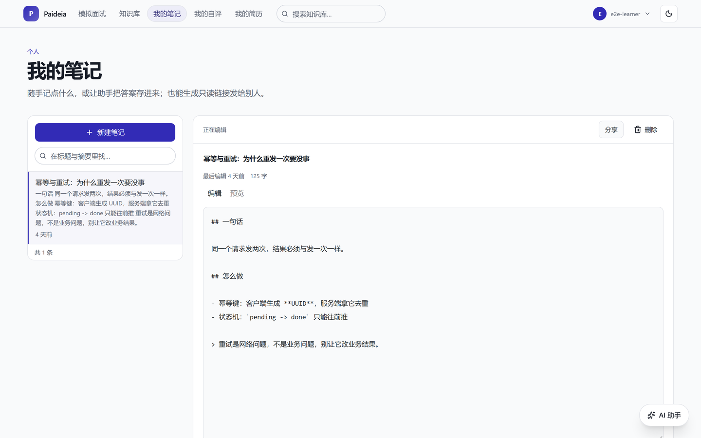
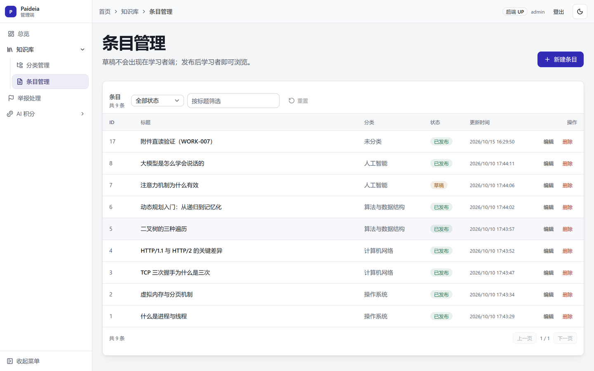

# Paideia

**一个会记住你的个性化学习平台。** 读知识库、跟着课程从零学、跟 AI 助手追问、模拟面试、把学到的东西记成笔记——这些行为沉淀成你自己的学习痕迹，再反过来影响推荐和你面前那个助手。

<p>
  
  
  
  
  
</p>



## 这是什么

Paideia 把三件事放进同一个站点：

1. **内容**——结构化知识库（分类树 + 条目 + 搜索 + 自评标记），以及两门从零开始的编程课。
2. **AI**——一个常驻右侧的助手。它知道你正在读哪一条内容，记得你之前说过什么，答案能一键存成笔记；还有一个一次问一个问题的模拟面试官。
3. **痕迹**——自评、阅读进度、笔记、简历版本都留在这个账号下，"我标记过"和"继续学习"都从这些记录里长出来。

AI 由平台统一出账，用户按积分消耗，不需要自备 Key。内容、对象存储与代码都在同一台自托管服务器上，除了模型 API 本身不依赖外部托管服务。

## 界面

**知识库**：分类是层级树，点进去才是条目；条目正文有目录、关系邻域和自评。

| 分类 | 条目 |
| --- | --- |
|  |  |

**AI 助手**：读当前条目，能对话、能生成带小标题的精简卡片（公开或只给自己）、能记住你、能看积分余量。窄屏会自动降级成抽屉。



**求职面**：模拟面试按目标岗位提问，结束后可生成结构化点评；简历支持站内编辑、体检、版本与按岗位优化。

| 模拟面试 | 简历 |
| --- | --- |
|  |  |

**个人与内容**：身份与目标决定推荐顺序（不限制权限）、笔记支持 Markdown 与只读分享链接。

| 身份与目标 | 我的笔记 |
| --- | --- |
|  |  |

**管理端**：独立的管理界面，负责分类、条目、概念、举报处理与 AI 积分发放/审计。



## 功能一览

| 能力 | 说明 |
| --- | --- |
| 知识库 | 分类树、条目正文、全文搜索、附件、条目间关系、自评（懂了／还不懂） |
| 从零课程 | Python / Java 两条学习线，一课约二十分钟，按站序推进并记录进度 |
| AI 助手 | 对话、精简卡片、记忆（自动提取 + 三开关控制面）、积分与用量 |
| 模拟面试 | 多轮提问、流式回答、结构化点评 |
| 简历 | 上传识别、站内编辑、体检建议、版本、按岗位优化 |
| 笔记 | Markdown 编辑与预览、只读分享、举报 |
| 身份 | 求职者等身份影响推荐顺序与助手形态，不构成权限 |
| MCP 接入 | 外部助手（ZCode、Claude Desktop 等）通过访问令牌读写你的内容 |
| 代码沙箱 | 可运行练习，**默认关闭**，需要本机 Docker |
| 桌面端 | Electron 外壳，与 Web 共用同一套前端产物 |

## 快速开始

### 前置

JDK 25、Maven 3.9+、Node 20.19+（或 22.12+）、pnpm 12、MySQL 8。

### 1. 建库

```sql
CREATE DATABASE paideia CHARACTER SET utf8mb4 COLLATE utf8mb4_0900_ai_ci;
```

### 2. 本地配置

复制 `backend/config/` 下的示例，写成**被 `.gitignore` 忽略**的 `application-local.yml`。至少需要：

```yaml
spring:
  datasource:
    url: jdbc:mysql://127.0.0.1:3306/paideia?connectionTimeZone=UTC&forceConnectionTimeZoneToSession=true&characterEncoding=utf8
    username: <你的账号>
    password: <你的口令>
paideia:
  auth:
    secret: <一串足够长的随机字符>
```

`connectionTimeZone=UTC` 与 `forceConnectionTimeZoneToSession=true` 必须成对出现，否则写入的时间会差 8 小时。

**没配 SMTP 时应用会启动失败**——验证码写日志等于注册后门，所以装配层宁可拒绝启动。只是想本地跑起来，加一行 `paideia.mail.allow-log-fallback: true`（仅限本地）。

### 3. 起后端

```bash
cd backend
mvn -B -DskipTests package
java -jar paideia-app/target/paideia-app-0.0.1-SNAPSHOT.jar --spring.profiles.active=local
```

工作目录必须是 `backend/`，配置从这里读 `./config/application-local.yml`。Flyway 会自动建表；种子数据（示例条目、演示账号）在 `db/devdata`，默认不加载，需要时加进 `spring.flyway.locations`。

### 4. 起前端

```bash
cd frontend
pnpm install
pnpm dev          # 学习者端 http://localhost:5173
pnpm dev:admin    # 管理端   http://localhost:5174
```

桌面安装包：`pnpm -w build:desktop`（首次会下载 Electron，约 20 分钟）。

## 仓库结构

```
backend/           Spring Boot 4 多模块，每个模块一个 Maven 工程
  paideia-app        启动模块，也是集成测试的落点
  paideia-account    注册登录、验证码、令牌轮换、账号注销
  paideia-security   鉴权与授权规则
  paideia-knowledge  知识库、分类、条目、附件
  paideia-ai         助手 harness、对话、记忆、积分、简历与面试
  paideia-note       笔记与分享
  paideia-mcp        MCP 网关与工具目录
  paideia-sandbox    代码执行
  paideia-persistence / paideia-web / paideia-platform   数据访问、Web 基础设施、共享契约
frontend/          pnpm workspace
  apps/app           学习者端（Web + 桌面共用）
  apps/admin         管理端
  apps/desktop       Electron 外壳
  apps/ui-kit        组件展览（仅开发）
  packages/ui        设计系统：令牌、基元、外壳、markdown 渲染
  packages/core      端口与 API 客户端
  packages/auth      登录门与令牌存储
  packages/assistant 助手面板与 SSE 客户端
  packages/knowledge 知识库客户端与阅读件
  packages/identity  身份配置
  packages/resume    简历编辑与体检
content/courses/   课程源文件（markdown + front matter，导入成条目）
scripts/           测试库、课程导入、发版
docs/screenshots/  README 用的截图
```

约束：业务代码不得直接依赖模型客户端的类型（收在 `paideia-ai` 的端口之后）；前端不得引用桌面壳专有 API（收在 `@paideia/platform-*` 适配器之后）。

## 测试

三层，各有各的跑法：

```bash
# 后端单测（不碰库，几秒）
cd backend && mvn -B -pl paideia-ai test

# 后端全量（含集成测试，需要测试库）
scripts/test-db.sh

# 前端单测与类型检查
cd frontend && pnpm -r test && pnpm -r typecheck

# 端到端（改动哪一端就跑哪一端）
cd frontend && ../scripts/test-db.sh pnpm --filter @paideia/app test:e2e
cd frontend && ../scripts/test-db.sh pnpm --filter @paideia/admin test:e2e
```

**所有碰数据库的验证都走 `scripts/test-db.sh`**：它给每次运行分配一个独占的 `paideia_run_<时间>_<pid>` 数据库，成功后自动删除。共用同一个库会让并行会话互相删数据，单类跑全绿、全量跑红。

还有一个陷阱：**没配测试库口令时，集成测试是"整模块跳过"而不是失败，构建仍然成功**。看结果要盯 `Skipped` 那一列，不要只看 `BUILD SUCCESS`。

## 部署

一个 jar 同时提供 API 与前端静态资源：学习者端在 `/`，管理端在 `/admin/`。配置、口令与上游凭据只存在于服务器上，不进仓库。

## 文档与协作

工程约定、决策记录、需求工件在 `.agent/`：常驻规范看 [`.agent/rules/always.md`](.agent/rules/always.md)，模块导航看 [`.agent/INDEX.md`](.agent/INDEX.md)，变更历史看 [`.agent/history/updates.md`](.agent/history/updates.md)。仓库是公开的，**任何凭据都不写入被 Git 跟踪的文件**。

## 授权

许可证尚未选定，当前保留所有权利。打算引用或复用其中代码，请先提 issue 沟通。
