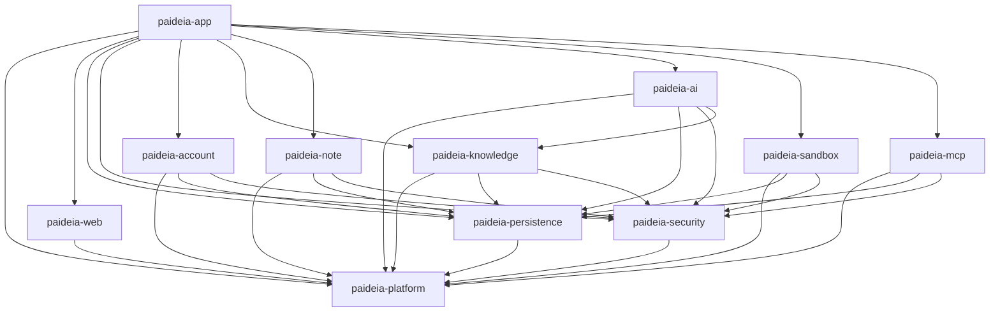

<!--
  本文件由 scripts/gen-arch-diagram.mjs 生成，**不要手改**。
  手改会让 `node scripts/gen-arch-diagram.mjs --check` 失败（那是刻意的：这张图必须等于 pom 的事实）。
  要改图就改 pom 或改生成脚本，然后重跑生成。
-->

# 后端模块依赖

由 `backend/pom.xml` 的 11 个模块生成。箭头方向是**依赖方 → 被依赖方**，
所以箭头指向的模块可以不知道调用者的存在（依赖只许单向下行，`spring-modulith` 在构建期挡循环）。

## 各模块的直接依赖

| 模块 | 直接依赖 |
| --- | --- |
| `paideia-platform` | （无） |
| `paideia-web` | `paideia-platform` |
| `paideia-persistence` | `paideia-platform` |
| `paideia-security` | `paideia-platform` |
| `paideia-account` | `paideia-platform`、`paideia-persistence`、`paideia-security` |
| `paideia-knowledge` | `paideia-platform`、`paideia-persistence`、`paideia-security` |
| `paideia-note` | `paideia-platform`、`paideia-persistence`、`paideia-security` |
| `paideia-ai` | `paideia-platform`、`paideia-persistence`、`paideia-security`、`paideia-knowledge` |
| `paideia-sandbox` | `paideia-platform`、`paideia-persistence`、`paideia-security` |
| `paideia-mcp` | `paideia-platform`、`paideia-persistence`、`paideia-security` |
| `paideia-app` | `paideia-platform`、`paideia-web`、`paideia-persistence`、`paideia-security`、`paideia-account`、`paideia-knowledge`、`paideia-note`、`paideia-ai`、`paideia-sandbox`、`paideia-mcp` |
