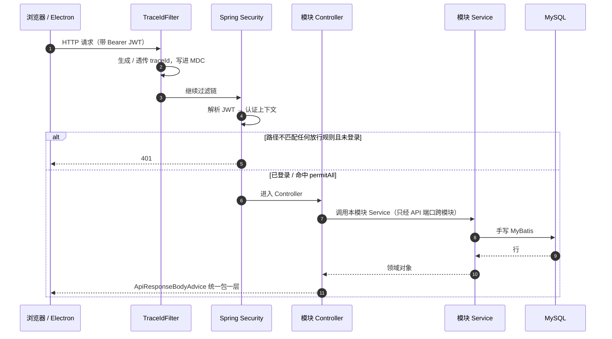
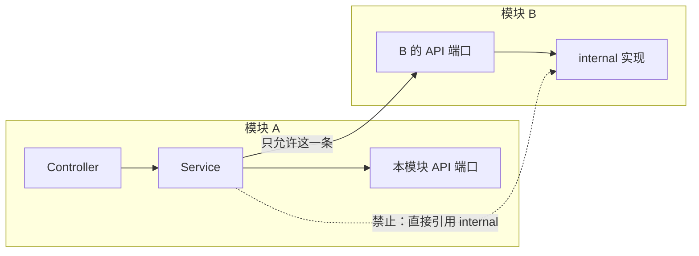
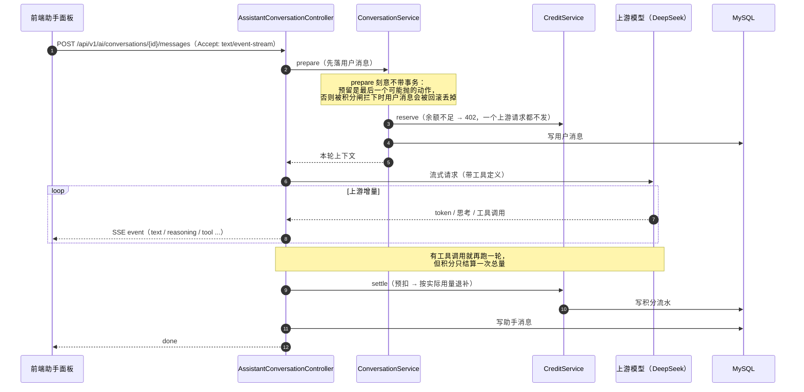

# 请求链路

这份图回答"一个请求进来之后，会经过哪些地方"。它属于**叙述性**的图——答案在代码语义里，抽取不出来，所以由人/AI 撰写，不生成。

## 普通请求的时序

**过滤顺序要点**：`TraceIdFilter` 是 `HIGHEST_PRECEDENCE`，所以它比安全链更早，认证失败的那条路径也带 traceId。安全规则按**声明顺序**取第一个匹配项——把 `/admin/**` 的 `hasRole('ADMIN')` 写在宽的 `/api/**` 规则之后，它**永不生效且不报错**，这是本仓库最容易被静默破坏的一处。

## 模块之间的调用规则

跨模块只能走对方的 **API 端口**（模块包根目录下的接口，如 `KnowledgeApi` / `AccountApi` / `NoteApi`），不许碰 `internal` 下的实现。`spring-modulith` 在构建期校验这条：跨模块访问内部实现或出现循环依赖会直接让构建失败。

## AI 流式回答的时序

这是全仓唯一一条**不按"请求-响应"收尾**的链路：由 `SseEmitter` 持有连接，上游增量逐个推下去。

三处容易画错、实际必须按这里画的点：

- 预留必须在写用户消息**之后**、且 `prepare` 不能包事务。反过来的话，被 402 拦下的那一轮里用户的消息会随事务回滚消失，而界面因为只有本地乐观状态，看不出来——刷新才丢。
- 工具循环里**每一轮都是真实上游调用**，但账只结一次。曾经只上报最后一轮的用量，实测对不上账。
- 思考内容（reasoning）不能进对话历史，只用于展示。
