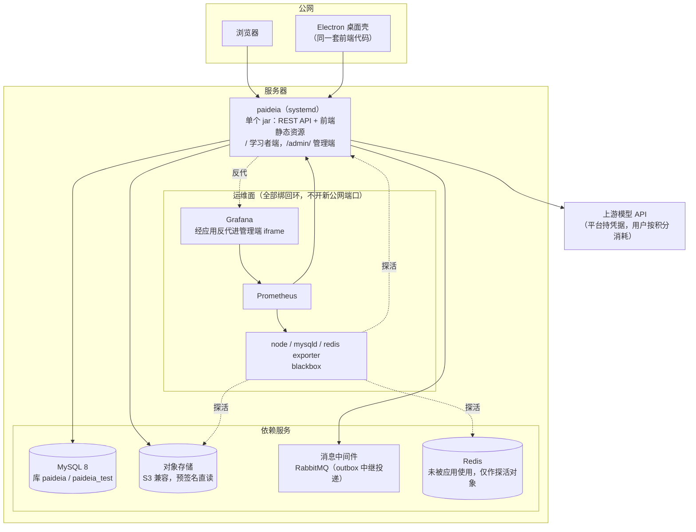
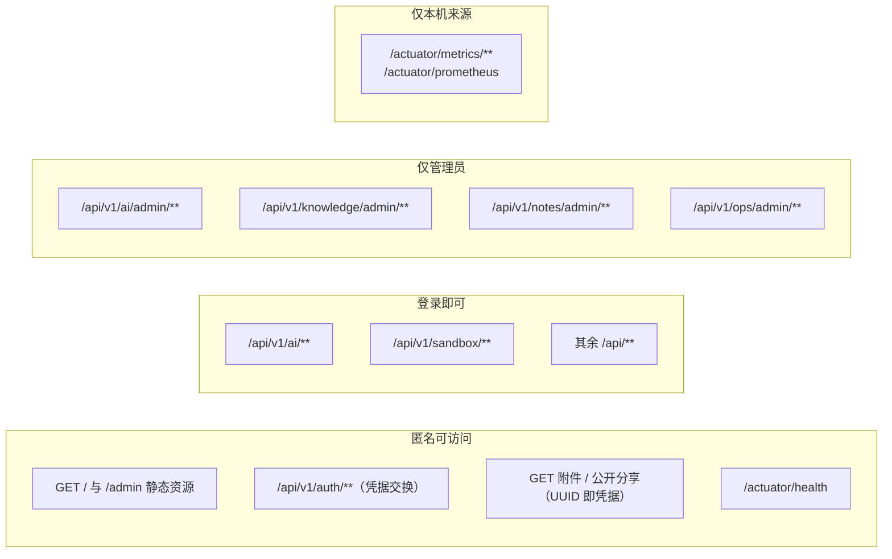
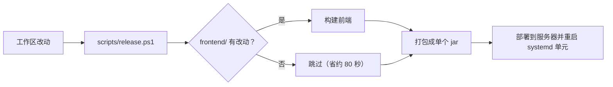

# 部署形态

这份图回答"东西都跑在哪、谁连谁"。**坐标与凭据一律不写在这里**——本仓库是公开仓库，服务器地址、口令、密钥只存在于被 `.gitignore` 忽略的本地配置和服务器上 600 权限的 env 文件里。

## 单机部署的拓扑

一个 jar 同时提供 API 与前端静态资源，管理端挂在 `/admin/` 路径下。公网只开一个应用端口。

几个**读图时容易误判**的地方：

- **Redis 不是应用的依赖。**它跑着、被探活着，但应用一行 Redis 代码都没有（`OpsSummaryService` 里明写"未被应用使用"）。看到它在图上就以为要配 Redis，是常见误会。
- **运维面没有独立公网端口。**Prometheus / Grafana / 各 exporter 全绑回环，Grafana 只能经应用的反代进管理端。所以"运维面板打不开"要先看应用是否活着。
- **对象存储的读路径是 302 预签名直读**，不经过应用转发。代价是每次新签名 URL 都会被浏览器当新资源，**吃掉一年的静态缓存**（折中：302 本身缓存 1 小时）。
- 附件读取与公开分享是**全项目仅有的免鉴权读端点**，安全性靠 UUID 不可枚举，不靠认证。改这两条路径前先想清楚这一点。

## 请求的信任边界

规则按**声明顺序**取第一个匹配项，所以 `/admin/**` 这类 `hasRole('ADMIN')` 必须排在任何更宽的 `/api/**` 规则**之前**。顺序写反不会报错，只会在某天表现为"任何登录用户都能改知识库"。

## 构建与发布

`release.ps1` 从**当前工作区**构建，所以带别人的未完成改动发版会把它们一起发出去——发版前先确认工作区干净。
