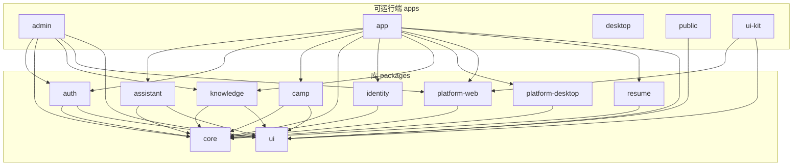

<!--
  本文件由 scripts/gen-arch-diagram.mjs 生成，**不要手改**。
  手改会让 `node scripts/gen-arch-diagram.mjs --check` 失败（那是刻意的：这张图必须等于 package.json 的事实）。
  要改图就改依赖声明或改生成脚本，然后重跑生成。
-->

# 前端包依赖

由 `frontend/` 的 15 个 workspace 包生成（`packages/*` 是库，`apps/*` 是可运行端）。
只画**包之间**的依赖，外部依赖（React、Vite 等）不画。箭头方向是**依赖方 → 被依赖方**。

## 各包的直接依赖

| 包 | 目录 | 直接依赖 |
| --- | --- | --- |
| `@paideia/assistant` | `packages` | `@paideia/core`、`@paideia/ui` |
| `@paideia/auth` | `packages` | `@paideia/core`、`@paideia/ui` |
| `@paideia/camp` | `packages` | `@paideia/core`、`@paideia/ui` |
| `@paideia/core` | `packages` | （无） |
| `@paideia/identity` | `packages` | `@paideia/core` |
| `@paideia/knowledge` | `packages` | `@paideia/core`、`@paideia/ui` |
| `@paideia/platform-desktop` | `packages` | `@paideia/core` |
| `@paideia/platform-web` | `packages` | `@paideia/core` |
| `@paideia/resume` | `packages` | `@paideia/core` |
| `@paideia/ui` | `packages` | （无） |
| `@paideia/admin` | `apps` | `@paideia/auth`、`@paideia/core`、`@paideia/knowledge`、`@paideia/platform-web`、`@paideia/ui` |
| `@paideia/app` | `apps` | `@paideia/assistant`、`@paideia/auth`、`@paideia/camp`、`@paideia/core`、`@paideia/identity`、`@paideia/knowledge`、`@paideia/platform-desktop`、`@paideia/platform-web`、`@paideia/resume`、`@paideia/ui` |
| `@paideia/desktop` | `apps` | （无） |
| `@paideia/public` | `apps` | `@paideia/ui` |
| `@paideia/ui-kit` | `apps` | `@paideia/platform-web`、`@paideia/ui` |

`@paideia/desktop` 是 Electron 外壳，它的"依赖"是构建期的 app 产物（脚本里 `--filter @paideia/app build:desktop`），
不是包依赖，所以图上没有边。
