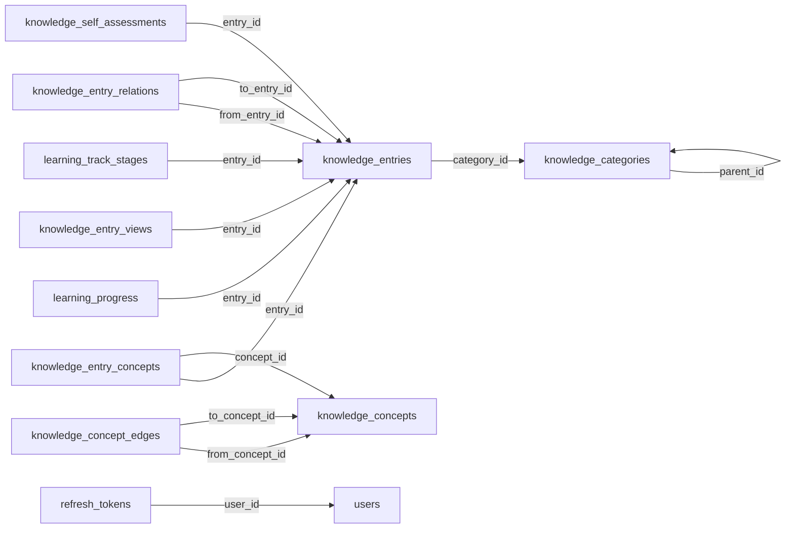

<!--
  本文件由 scripts/gen-arch-diagram.mjs 生成，**不要手改**。
  手改会让 `node scripts/gen-arch-diagram.mjs --check` 失败（那是刻意的：这张图必须等于迁移文件的事实）。
  要改图就改迁移文件或改生成脚本，然后重跑生成。
-->

# 数据库表

由 `backend/paideia-app/src/main/resources/db/migration/` 的 29 个迁移生成：
共 **48 张表**，其中只有 **13 条外键**。

外键少是**刻意的**，不是遗漏：跨模块的关联（比如 `ai_memories_structured.user_id` → `users.id`）
由应用层保证，不交给数据库。所以下面这张图只画**有真实外键约束**的关系，
看不到关联不代表没关系——去读 mapper 或实体。

## 全部表

| 表 | 迁移 | 外键 |
| --- | --- | --- |
| `ai_conversations` | `V5__create_assistant_tables` | （无） |
| `ai_credit_accounts` | `V11__create_credit_tables` | （无） |
| `ai_credit_ledger` | `V11__create_credit_tables` | （无） |
| `ai_entry_summaries` | `V4__create_ai_tables` | （无） |
| `ai_interview_evaluations` | `V14__create_learner_profiles` | （无） |
| `ai_memories_structured` | `V6__create_memory_tables` | （无） |
| `ai_memories_text` | `V6__create_memory_tables` | （无） |
| `ai_messages` | `V5__create_assistant_tables` | （无） |
| `ai_model_credentials` | `V4__create_ai_tables` | （无） |
| `ai_run_payloads` | `V20261021181500__create_ai_run_payloads` | （无） |
| `ai_run_spans` | `V21__create_ai_telemetry_tables` | （无） |
| `ai_runs` | `V21__create_ai_telemetry_tables` | （无） |
| `ai_user_settings` | `V12__memory_auto_extraction_and_settings` | （无） |
| `camp_attempts` | `V20261021135406__create_camp_tables` | （无） |
| `camp_items` | `V20261021135406__create_camp_tables` | （无） |
| `camp_plans` | `V20261021135406__create_camp_tables` | （无） |
| `camp_programs` | `V20261021135406__create_camp_tables` | （无） |
| `camp_tasks` | `V20261021135406__create_camp_tables` | （无） |
| `code_runs` | `V13__create_code_runs` | （无） |
| `concept_mastery_state` | `V20261022170000__create_question_attempts_and_mastery` | （无） |
| `digest_items` | `V20261021161000__create_digest_tables` | （无） |
| `digest_weeklies` | `V20261021161000__create_digest_tables` | （无） |
| `knowledge_categories` | `V3__create_knowledge_tables` | `parent_id` → `knowledge_categories` |
| `knowledge_concept_edges` | `V19__create_concept_and_view_tables` | `from_concept_id` → `knowledge_concepts`、`to_concept_id` → `knowledge_concepts` |
| `knowledge_concepts` | `V19__create_concept_and_view_tables` | （无） |
| `knowledge_entries` | `V3__create_knowledge_tables` | `category_id` → `knowledge_categories` |
| `knowledge_entry_concepts` | `V19__create_concept_and_view_tables` | `entry_id` → `knowledge_entries`、`concept_id` → `knowledge_concepts` |
| `knowledge_entry_relations` | `V3__create_knowledge_tables` | `from_entry_id` → `knowledge_entries`、`to_entry_id` → `knowledge_entries` |
| `knowledge_entry_views` | `V19__create_concept_and_view_tables` | `entry_id` → `knowledge_entries` |
| `knowledge_files` | `V3__create_knowledge_tables` | （无） |
| `knowledge_self_assessments` | `V3__create_knowledge_tables` | `entry_id` → `knowledge_entries` |
| `learner_profiles` | `V14__create_learner_profiles` | （无） |
| `learning_progress` | `V18__create_learning_progress` | `entry_id` → `knowledge_entries` |
| `learning_track_stages` | `V22__create_learning_tracks` | `entry_id` → `knowledge_entries` |
| `learning_tracks` | `V22__create_learning_tracks` | （无） |
| `mcp_access_tokens` | `V16__create_mcp_access_tokens` | （无） |
| `note_reports` | `V9__create_note_report_tables` | （无） |
| `note_shares` | `V8__create_note_share_tables` | （无） |
| `notes` | `V7__create_note_tables` | （无） |
| `question_attempts` | `V20261022170000__create_question_attempts_and_mastery` | （无） |
| `question_concepts` | `V20261022170000__create_question_attempts_and_mastery` | （无） |
| `question_difficulty` | `V20261022170000__create_question_attempts_and_mastery` | （无） |
| `refresh_tokens` | `V1__create_account_tables` | `user_id` → `users` |
| `resume_documents` | `V15__create_resume_tables` | （无） |
| `resume_edit_history` | `V15__create_resume_tables` | （无） |
| `resume_proposals` | `V15__create_resume_tables` | （无） |
| `resume_versions` | `V15__create_resume_tables` | （无） |
| `users` | `V1__create_account_tables` | （无） |
